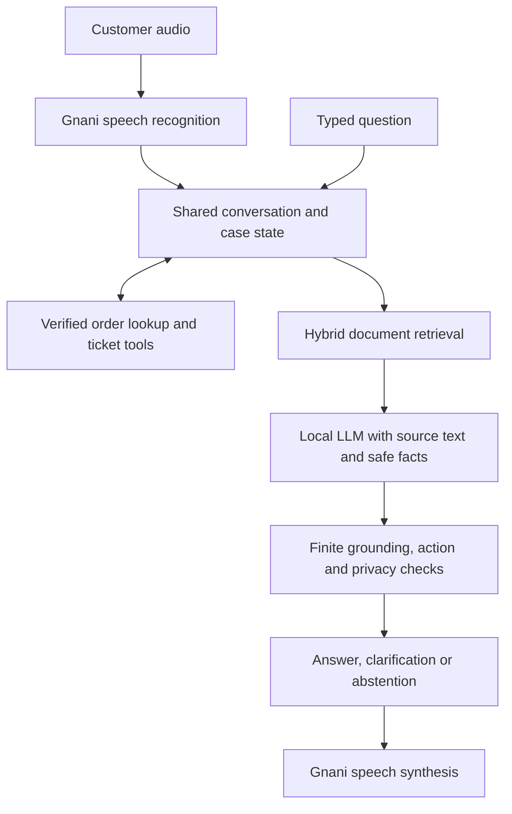

# Inside Resolvox: From Voice to Verified Answers

> Engineering Deep Dive · VoiceOps 2026 Capstone

Resolvox turns a spoken or typed customer question into a document-grounded answer, a request for missing information or a confirmed support-ticket handover. Its central engineering challenge is keeping policy knowledge, private order facts and completed actions distinct throughout a conversation.

[Back to README](README.md) · [Technical report](report.pdf) · [Verification evidence](VERIFICATION.md)

## The Problem

ZentroMart is the fictional retailer in the supplied synthetic dataset. Customers need help with orders, delivery, returns, refunds and product support. A useful assistant must find the applicable policy, preserve context through follow-ups and avoid revealing order information before verification.

A fluent answer alone is insufficient. A return window needs the correct product context; a refund timeline needs the correct starting event; and a claim that a ticket exists needs a successful tool result.

## The Customer Experience

One conversation accepts both **Speak** and **Type** input. Switching modes preserves the conversation and verified case context.

- **Your conversation** contains messages, reply audio and relevant supporting policies.
- **Your case** stays compact until order or action context is needed. Private order details appear after verification.
- **Your next step** appears when clarification or handover guidance is needed.

The Streamlit interface adapts to desktop and mobile screens. Customer-facing evidence excludes internal conversation-style instructions; complete source records remain available in saved outputs.

## From Input to Answer

Retrieval combines lexical matching with multilingual MiniLM embeddings through quantized ONNX. Raw and expanded queries help recover relevant sections, while document references supply related policy context. The selected local answer model is `qwen3:4b-instruct` through Ollama.

The model receives actual document text and permitted facts. Recorded outputs preserve retrieved chunk IDs, source text, generation context and tool traces so reviewers can inspect what supported a reply.

## Decisions That Shape the System

| Decision | Engineering reason | Trade-off |
| --- | --- | --- |
| Shared agent for speech and text | Keeps verification, follow-ups and actions consistent across input modes | Both modes depend on the same session state |
| Local LLM and retrieval | Allows text processing on the laptop after setup | CPU generation can be slow |
| Hybrid retrieval | Combines exact terminology with semantic similarity | Retrieved relevance still needs answer validation |
| One bounded repair, then abstention | Limits retries when generated output violates checks | Some requests receive uncertainty instead of a complete answer |
| Tool-confirmed ticket status | Prevents generated text from inventing a completed handover | Tool failure must remain visible to the customer |
| Gnani-only speech | Keeps recognition and synthesis aligned with the brief | Full voice operation requires internet access |

Policy replies use retrieved sources rather than a lookup of prepared answers for practice questions. Deterministic code still manages session state, verification, supported calculations and tool outcomes. These operational controls are separate from generated policy explanations.

## What Failed and What Changed

Development exposed several distinct failure modes:

- **Missing relevant policies:** query expansion and hybrid retrieval improved access to answer-bearing sections and their dependencies.
- **Incomplete or mis-scoped replies:** source-derived checks and repair context address defined missing conditions, quantities and refund-clock roles.
- **Unsupported claims:** grounding checks can reject recognized invalid claims, attempt one repair and abstain when validation still fails.
- **Private facts or invented actions:** verification gates restrict order access, proofs are redacted, and ticket success follows the actual tool result.
- **Confusing customer evidence:** the interface filters internal guidance from the supporting-policy panel without deleting saved provenance.

These fixes target general retrieval, validation and state behavior. Finite checks do not establish that every sentence is supported or that every unseen question will be answered correctly.

## Recorded Outcomes

| Check | Recorded result | Interpretation |
| --- | --- | --- |
| Prompt-only baseline | 1/52 | Historical run using `qwen3:1.7b` |
| Grounded practice checks | 52/52 accumulated | Saved outputs and targeted retests across revisions |
| Selected conversations | 18/18 turns, plus 2/2 refund edge cases | Selected scenario coverage |
| Refund and reporting regressions | 371 passed | Automated regression checks, separate from live inference |
| Primary-language speech | 3/3 selected synthetic round trips | English, Hindi and Hinglish; Hindi retested separately |

The baseline and selected answer model differ, so these results are not a controlled same-model comparison. The accumulated practice total is not a fresh complete run of the current implementation or an organizer score. Receipts, revision boundaries and speech provenance are linked in [VERIFICATION.md](VERIFICATION.md).

## Practical Limits

Selected generated turns took **12.4–257.1 seconds** on the recorded CPU setup. Local deployment therefore trades speed for local text processing. Gnani speech needs connectivity, and synthetic audio checks do not establish real-speaker, accent, noise or subjective listening quality.

English, Hindi and Hinglish are the primary scope. Additional regional routes are experimental previews. The supplied verification and ticket tools operate on synthetic data; this is a capstone support prototype, without a real refund or cancellation execution API.

The next validation steps are fresh unseen customer scenarios, own-voice and noisy-room checks, and latency measurements on the intended deployment hardware.

## Explore the Implementation

- [DESIGN.md](DESIGN.md): retrieval, state transitions, operational guards and privacy boundaries.
- [VERIFICATION.md](VERIFICATION.md): measurements, provenance and limitations.
- [src/agent.py](src/agent.py): shared session and tool orchestration.
- [src/retrieval.py](src/retrieval.py): hybrid document retrieval.
- [src/document_answers.py](src/document_answers.py): document-context generation and validation.
- [app.py](app.py): the customer support workspace.
