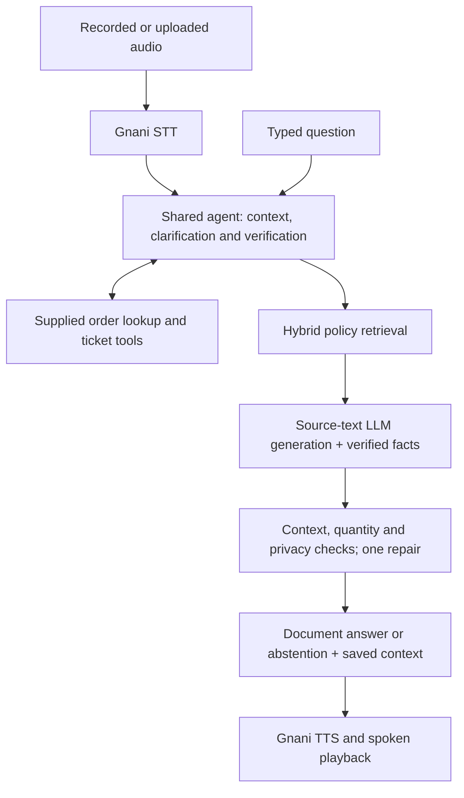

<p align="center">
  
</p>

<h1 align="center">Resolvox</h1>

<p align="center">
  <strong>Multilingual voice and text support for ZentroMart</strong><br>
  VoiceOps 2026 Capstone · From Tokens to Transformers
</p>

<p align="center">
  
  
  
  
  
</p>

Resolvox answers customer questions from ZentroMart’s documents, looks up verified orders and creates human-support tickets when needed. Voice and text share the same conversation, retrieval and tools.

**Primary languages:** English, Hindi and Hinglish.

Capstone for **From Tokens to Transformers**, organized by the Consulting & Analytics Club, IIT Guwahati × Gnani.ai.

[Demo](#demo-video) · [Quick Start](#quick-start) · [Batch Command](#organizer-batch-command) · [Architecture](#architecture) · [Evaluation](#evaluation) · [Submission](#submission-status) · [Documentation](#documentation)

## Demo Video

> Demo video — recording to be added here.

<!-- Add the actual recording link or embedded video here after the final own-voice rehearsal. -->

## What Resolvox Does

| Capability | How it works |
| --- | --- |
| Policy answers with sources | Searches policy sections, supplies actual text to the answer model and saves the complete generation context. |
| Context across turns | Handles follow-up questions, missing details and clarification within one conversation. |
| Verified order support | Checks a phone suffix or delivery pincode before revealing private order information. |
| Confirmed handover | Creates a ticket with the supplied tool and reports success only after confirmation. |
| Voice and text | Uses one shared agent for typed questions and Gnani speech input/output. |
| Uncertainty handling | Attempts one bounded repair of invalid model output, then abstains if a supported answer is unavailable. |

### Using the Application

Choose **Voice support** to record or upload audio, or **Text support** to type a question. Provide an order ID and verification detail when requested. Replies include expandable sources and confirmed tool outcomes.

The layout adapts to phone, tablet and desktop widths. Both tabs share conversation state. **New conversation** clears that state and verification; **Retry reply audio** retries speech without repeating the agent action. Under **Advanced options**, AI policy answers are enabled by default and extra language previews are disabled.

## Quick Start

### Prerequisites

- **Python 3.11**, the tested Python version, and Git.
- **Ollama** installed for the default local LLM, or a compatible hosted LLM endpoint.
- Your own **Gnani API key** for speech, available from the [Gnani voice dashboard](https://app.gnani.ai/voice).
- Internet access for the initial dependency, dataset and model downloads, and for Gnani speech calls.

The tested environment is Windows with Python 3.11. Setup downloads and validates the official synthetic dataset and downloads the pinned embedding model. Regional translation weights are optional.

**Connectivity:** local retrieval and Ollama text generation can run offline after setup. Gnani speech recognition and synthesis require internet access; the complete voice application is not fully offline.

### 1. Clone and Install

```sh
git clone https://github.com/Pranay207/Resolvox.git
cd Resolvox
```

**Windows PowerShell:**

```powershell
powershell -ExecutionPolicy Bypass -File .\setup.ps1
```

The Windows setup creates `.venv` and copies `.env.example` to `.env` if needed.

**macOS / Linux:**

```sh
python3.11 -m venv .venv
.venv/bin/python -m pip install --upgrade pip
.venv/bin/python setup.py --models
cp .env.example .env
```

### 2. Configure Speech and the LLM

Edit your local `.env` before launching the app:

```dotenv
GNANI_API_KEY=your_gnani_api_key
LLM_PROVIDER=ollama
LLM_BASE_URL=http://127.0.0.1:11434
LLM_MODEL=qwen3:4b-instruct
LLM_TIMEOUT=600
RAG_LLM_TIMEOUT=600
COMPOSE_WITH_LLM=true
```

Keep the remaining defaults from [.env.example](.env.example), including `REFERENCE_DATE=2026-10-20`. Credentials belong only in the ignored `.env`; use synthetic or consented audio.

Start Ollama in a separate terminal if it is not already running:

```sh
ollama serve
```

Then download the model from another terminal:

```sh
ollama pull qwen3:4b-instruct
```

The setup above uses Ollama’s default port **11434**, matching `.env.example`. The recorded laptop checks used **11435**; to reproduce that endpoint, set `OLLAMA_HOST=127.0.0.1:11435` before starting Ollama and set `LLM_BASE_URL=http://127.0.0.1:11435` in `.env`. The two ports must match.

<details>
<summary>Use a compatible hosted LLM instead</summary>

Set `LLM_PROVIDER=compatible`, `LLM_BASE_URL`, `LLM_MODEL` and `LLM_API_KEY` in `.env`. Optional `LLM_FALLBACK_*` settings configure a second LLM endpoint. Gnani remains the only speech provider.

</details>

### 3. Launch the Support Console

**Windows PowerShell:**

```powershell
.\.venv\Scripts\python.exe -m streamlit run app.py
```

**macOS / Linux:**

```sh
.venv/bin/python -m streamlit run app.py
```

Open [localhost:8501](http://localhost:8501). Choose the spoken language and **Record** or **Upload**, then send a clip of up to **60 seconds**. Uploads are limited to **20 MB**. Text support uses the same conversation and verification state.

## Organizer Batch Command

With the virtual environment activated, the required command is:

```sh
python run.py --audio_dir <in> --out_dir <out>
```

For example, on Windows:

```powershell
.\.venv\Scripts\python.exe run.py --audio_dir .\input_audio --out_dir .\sample_outputs\batch
```

Each clip produces answer text, JSON, full source chunks and an actual Gnani reply WAV when speech succeeds. `manifest.json` records per-file outcomes and failures. Speech failures are recorded without substitute audio.

<details>
<summary>Audio formats, sessions and exit codes</summary>

- Formats: WAV, MP3, OGG, FLAC, AAC and M4A; Gnani REST clips are limited to 60 seconds, and WAV duration is checked locally.
- Language: `--language hi-IN` selects Hindi; `en-IN` accepts English/Hinglish. Additional routes are listed under [Language support](#language-support).
- Sessions: files are independent by default. In auto mode, `call_id__001.wav` and `call_id__002.wav` share context. Use `--session_mode sequential` for one folder-wide session, or `sessions.json` for explicit mapping.
- Exit codes: `0` means all inputs succeeded, `1` means failed or no inputs, and `2` means usage errors.
- `--offline-rules` disables LLM generation and displays document excerpts for diagnosis, alongside operational guards. It does not enable offline speech/regional translation.
- Raw input audio is not copied to outputs. Verification proofs are redacted from transcripts, tool arguments and model context.

</details>

## Architecture



| Component | Implementation |
| --- | --- |
| Interface | Responsive Streamlit console with Voice support and Text support tabs |
| Answer model | Local Ollama `qwen3:4b-instruct`; selected laptop endpoint on port 11435 |
| Retrieval | Lexical search + multilingual MiniLM embeddings using quantized ONNX |
| Speech | Gnani STT and TTS only |
| State and tools | Shared agent session with supplied dataset lookup/ticket tools |
| Optional regional translation | Local NLLB-200 distilled 600M ONNX model |

See [DESIGN.md](DESIGN.md) for the state model, retrieval strategy and evidence boundaries, and [THIRD_PARTY.md](THIRD_PARTY.md) for pinned models and licenses.

## Evaluation

Recorded local development results as of **31 October 2026**:

| Check | Recorded result | Evidence |
| --- | --- | --- |
| Step 1: prompt-only baseline | **1/52**, including one recorded error | [Baseline outputs](sample_outputs/eval_step1.json) |
| Step 2: grounded practice questions | **52/52 accumulated checks** across recorded revisions | [Question records](sample_outputs/eval_step2_latest_cases.json) |
| Selected conversation scenarios | **18/18 turns**, plus **2/2 refund edge cases** | [Targeted evidence](sample_outputs/targeted_live_validation.json) |
| Refund and reporting regressions | **371 passed** | [Test receipt](sample_outputs/refund_scope_verification_20261031.json) |
| Packaging and report regressions | **148 passed** | [Test receipt](sample_outputs/targeted_release_tests_20261031.json) |
| English, Hindi and Hinglish speech | **3/3 selected synthetic round trips**; Hindi retested separately | [Speech evidence](sample_outputs/targeted_voice_validation.json) |
| Official dataset validation | **Passed**: 9 CSVs and 21 knowledge-base documents | [Validator output](sample_outputs/engineering_artifacts/20261031T060814584432Z_92c93db5/dataset_validation.log) |

**Scope:** these are development checks, not organizer scores. The 52-question total combines preserved outputs and targeted retests; it is not a fresh complete run of the current revision. Selected conversation and speech evidence also identifies retained outputs and execution revisions. The baseline used `qwen3:1.7b`, while the selected model is `qwen3:4b-instruct`, so the comparison is not a controlled same-model experiment.

Synthetic audio does not establish real-speaker, accent or noise performance. Selected generated turns took **12.4–257.1 seconds** on the recorded CPU setup. See [VERIFICATION.md](VERIFICATION.md) for measurement limits and historical runs, and the [new-case UI smoke check](sample_outputs/ui_user_smoke_20261031.json) for interactive probes and their targeted fixes.

<details>
<summary>Verification commands</summary>

Activate the virtual environment before running these commands:

```sh
python Capstone_Project_Dataset_FTTT_2026/validate_dataset.py
python -m pytest -q
```

Selected live checks require the configured local LLM and, for speech, Gnani access:

```sh
python scripts/validate_targeted_live.py
python scripts/validate_targeted_voice.py
```

The original Step 1, Step 2 and Step 3 evaluation drivers remain available as `eval_step1.py`, `eval_step2.py` and `eval_step3.py`. Preserve previous outputs when changing the model or runtime configuration.

</details>

## Language Support

**English, Hindi and Hinglish are the primary scope.** Select the spoken language before recording. Additional regional languages are an optional preview, disabled by default.

Additional regional routes are experimental and have not been validated for the current revision. See the [recorded language checks](sample_outputs/language_validation.json) before enabling the preview.

<details>
<summary>Configure the optional regional preview and inspect voice routes</summary>

```sh
python scripts/setup_translation.py
```

This separately downloads approximately **907 MB** of pinned NLLB weights. Enable **Advanced options → Extra languages** afterward. Other regional languages use masked local translation around the same agent; placeholder, script and translation checks reject malformed output with a localized retry. These checks do not prove semantic equivalence. Choose Marathi explicitly because Hindi and Marathi share Devanagari; English/Hindi/Hinglish retain their existing path.

| Language | Batch/STT code | TTS voice |
| --- | --- | --- |
| English | `en-IN` | Kaveri |
| Hindi | `hi-IN` | Nalini |
| Hinglish | `en-IN` (TTS `hi-en`) | Poorvi |
| Bengali | `bn-IN` | Kirra |
| Gujarati | `gu-IN` | Falak |
| Kannada | `kn-IN` | Saanvi |
| Malayalam | `ml-IN` | Reshma |
| Marathi | `mr-IN` | Zahira |
| Punjabi | `pa-IN` | Mehuli |
| Tamil | `ta-IN` | Asmita |
| Telugu | `te-IN` | Suhana |

Mappings follow [Gnani's voice catalog](https://docs.gnani.ai/api/TTS/available-voices). Run `python scripts/validate_languages.py --languages te` for a Telugu synthetic pilot, or omit `--languages` for all ten plus Hinglish. Routing, valid audio and grounded meaning are checked separately.

</details>

## Submission Status

**Submission preparation is incomplete.** The demo is reserved above, repository access must be made public, and final ZIP creation is deferred until those steps are complete.

| Deliverable | Status |
| --- | --- |
| Code, setup and organizer command | Available; public GitHub access still needs confirmation |
| Report, maximum four pages | [report.pdf](report.pdf): four pages, visually reviewed |
| Answer text, sources and speech examples | Available in [sample_outputs/](sample_outputs/), with recorded verification scopes |
| Demo, maximum two minutes | Pending; record the final own-voice demonstration last |
| Submission ZIP | Pending; no submission archive has been created |

After adding the real `demo.mp4` and confirming public access, create and check the final archive:

```sh
python scripts/check_repository_visibility.py
python package_submission.py
python scripts/verify_package.py
```

The packager checks readiness and creates `dist/pranay_voiceops.zip`; `pranay` is the current team-name assumption. It excludes credentials, `.env`, the dataset copy, model weights, caches, virtual environments, the source brief and private input audio.

[SUBMISSION_STATUS.json](SUBMISSION_STATUS.json) records release blockers. [BRIEF_CHECKLIST.md](BRIEF_CHECKLIST.md) maps the implementation and evidence to the brief.

## Documentation

| Resource | Purpose |
| --- | --- |
| [DESIGN.md](DESIGN.md) | Architecture, retrieval, session state and privacy boundaries |
| [VERIFICATION.md](VERIFICATION.md) | Detailed measurements, historical failures and limitations |
| [BRIEF_CHECKLIST.md](BRIEF_CHECKLIST.md) | Requirement-by-requirement checklist |
| [DEMO_SCRIPT.md](DEMO_SCRIPT.md) | Plan for the final recording |
| [THIRD_PARTY.md](THIRD_PARTY.md) | Model revisions, dependencies and licensing |
| [.env.example](.env.example) | Configuration template without credentials |
| [sample_outputs/](sample_outputs/) | Recorded answer, source, tool and speech evidence |

### Data and API References

- [Official synthetic dataset](https://drive.google.com/file/d/1jeGjWgZJ4vdfmbB71kghovcCUYNeSHOY/view) — downloaded separately by setup.
- [VoiceOps 2026 capstone brief](https://d8it4huxumps7.cloudfront.net/uploads/submissions_case/6ad64c83eae85_voiceops_2026_capstone_brief.pdf).
- [Gnani speech-to-text API](https://docs.gnani.ai/api/STT/speech-to-text) and [text-to-speech API](https://docs.gnani.ai/api/TTS/tts-inference).
- [Multilingual MiniLM embedding model](https://huggingface.co/sentence-transformers/paraphrase-multilingual-MiniLM-L12-v2) — pinned quantized ONNX export; revision and Apache-2.0 attribution in [THIRD_PARTY.md](THIRD_PARTY.md).
