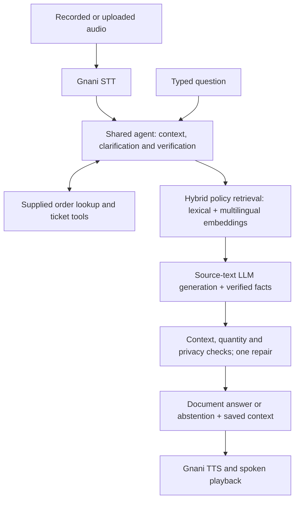

# Resolvox

**Multilingual AI Voice Support for ZentroMart**

**VoiceOps 2026 Capstone**


Resolvox helps online shoppers resolve questions about returns, refunds, deliveries and orders through voice or text. It retrieves ZentroMart policies, verifies access before disclosing private order information, and creates support handover tickets through the supplied tools.

**Primary languages:** English, Hindi and Hinglish.

Built for **From Tokens to Transformers**, Consulting & Analytics Club, IIT Guwahati × Gnani.ai.

[Demo Video](#demo-video) · [Quick Start](#quick-start) · [Architecture](#architecture) · [Evaluation](#evaluation) · [Languages](#language-support) · [Documentation](#documentation)

## Demo Video

> **Space reserved for the final demo video.**

<!-- Add the actual recording link or embedded video here after the final own-voice rehearsal. -->

## What Resolvox Does

| Capability | How it works |
| --- | --- |
| Policy answers with sources | Searches policy sections and supplies their text to the answer model; saves the sources used. |
| Context across turns | Handles follow-up questions, missing details and clarification within one conversation. |
| Verified order support | Checks a phone suffix or delivery pincode before revealing private order information. |
| Confirmed handover | Creates a ticket with the supplied tool and reports success only after confirmation. |
| Voice and text | Uses one shared agent for typed questions and Gnani speech input/output. |
| Uncertainty handling | Attempts one bounded repair of invalid model output, then abstains if a supported answer is unavailable. |

### Customer Workflow

1. **Ask:** type a question, record speech or upload an audio clip.
2. **Clarify:** the agent asks for missing details and verifies order access when needed.
3. **Resolve:** receive an answer with policy sources and, for voice requests, spoken playback.
4. **Escalate:** receive a confirmed handover ticket when the case needs human support.

The Streamlit console provides **Voice support**, **Text support** and **Evaluation** tabs. Conversation state, redacted transcripts and reply audio persist across reruns. **Retry reply audio** synthesizes the saved answer without repeating the agent action; **New conversation** clears the session and verification state.

## Quick Start

### Prerequisites

- **Python 3.11**, the tested Python version, and Git.
- **Ollama** installed for the default local LLM, or a compatible hosted LLM endpoint.
- Your own **Gnani API key** for speech, available from the [Gnani voice dashboard](https://app.gnani.ai/voice).
- Internet access for the initial dependency, dataset and model downloads, and for Gnani speech calls.

The recorded environment is Windows with Python 3.11. Setup downloads the official synthetic dataset separately, validates it, and obtains the pinned quantized multilingual embedding model. The optional regional translation model is downloaded only when explicitly requested.

### 1. Clone and Install

```sh
git clone https://github.com/Pranay207/Resolvox.git
cd Resolvox
```

**Windows PowerShell:**

```powershell
powershell -ExecutionPolicy Bypass -File .\setup.ps1
```

The Windows setup creates `.venv` and copies `.env.example` to `.env` if needed.

**macOS / Linux:**

```sh
python3.11 -m venv .venv
.venv/bin/python -m pip install --upgrade pip
.venv/bin/python setup.py --models
cp .env.example .env
```

### 2. Configure Speech and the LLM

Edit your local `.env` before launching the app:

```dotenv
GNANI_API_KEY=your_gnani_api_key
LLM_PROVIDER=ollama
LLM_BASE_URL=http://127.0.0.1:11434
LLM_MODEL=qwen3:4b-instruct
COMPOSE_WITH_LLM=true
```

Keep the remaining defaults from [.env.example](.env.example), including `REFERENCE_DATE=2026-10-20`. Credentials belong only in the ignored `.env`; use synthetic or consented audio.

Install the selected local model:

```sh
ollama pull qwen3:4b-instruct
```

The selected local model is `qwen3:4b-instruct`. The default per-request RAG timeout is 120 seconds; this is not a total response-time guarantee. Ensure Ollama is running. If its service is not already running, start `ollama serve` in a separate terminal.

<details>
<summary>Use a compatible hosted LLM instead</summary>

Set `LLM_PROVIDER=compatible`, `LLM_BASE_URL`, `LLM_MODEL` and `LLM_API_KEY` in `.env`. Optional `LLM_FALLBACK_*` settings configure a second LLM endpoint. Gnani remains the only speech provider.

</details>

### 3. Launch the Support Console

**Windows PowerShell:**

```powershell
.\.venv\Scripts\python.exe -m streamlit run app.py
```

**macOS / Linux:**

```sh
.venv/bin/python -m streamlit run app.py
```

Open **http://localhost:8501**. Choose the spoken language and **Record** or **Upload**, then send a clip of up to **60 seconds**. Uploads are limited to **20 MB**. Text support uses the same conversation and verification state.

## Organizer Batch Command

With the virtual environment activated, the required command is:

```sh
python run.py --audio_dir <in> --out_dir <out>
```

For example, on Windows:

```powershell
.\.venv\Scripts\python.exe run.py --audio_dir .\input_audio --out_dir .\sample_outputs\batch
```

Each clip produces answer text, JSON, full source chunks and an actual Gnani reply WAV when speech succeeds. `manifest.json` records per-file outcomes and failures. Speech failures are recorded without substitute audio.

<details>
<summary>Audio formats, sessions and exit codes</summary>

- Formats: WAV, MP3, OGG, FLAC, AAC and M4A; Gnani REST clips are limited to 60 seconds, and WAV duration is checked locally.
- Language: `--language hi-IN` selects Hindi; `en-IN` accepts English/Hinglish. Additional routes are listed under [Language support](#language-support).
- Sessions: files are independent by default. In auto mode, `call_id__001.wav` and `call_id__002.wav` share context. Use `--session_mode sequential` for one folder-wide session, or `sessions.json` for explicit mapping.
- Exit codes: `0` means all inputs succeeded, `1` means failed or no inputs, and `2` means usage errors.
- `--offline-rules` disables LLM generation and displays document excerpts for diagnosis, alongside operational guards. It does not enable offline speech/regional translation.
- Raw input audio is not copied to outputs. Verification proofs are redacted from transcripts, tool arguments and model context.

</details>

## Architecture



**Retrieval and generation.** Query-first search fuses raw and narrowly expanded lexical/dense queries at **k=12**. The model receives actual selected section text and metadata, sanitized verified/public records and calculations derived from retrieved policy inputs. It returns an answer and two boolean flags, `covered` and `needs_clarification`. The host derives the operational decision: clarify when a detail is needed, otherwise answer when covered, otherwise refuse. The host saves the complete actual generation context and its source IDs; these are context provenance, not model-selected citations. The normal prompt contains no authored policy answer or rule summary.

**Answer checks.** Numeric values/units, language, private identifiers and invented actions are checked against the actual supplied context and verified facts. Question-relevant category windows, calculated refund dates and delivery-attempt limits have source-bound numeric checks; repeated questions and one-word policy replies are rejected. Invalid output gets at most one repair; unavailable inference or another invalid output produces uncertainty. An uncovered reply must be non-substantive clarification or uncertainty. **Prewritten policy fallback is removed from normal answer generation.** Context provenance and finite validation do not prove per-claim semantic support, correct application of a condition or complete question coverage. Normal generation returns `citations=[]` rather than claiming exact model-selected quotes.

**Routing and operational guards.** The legacy planner still supplies routing hints and deterministic verification, privacy, safety, handover and limited missing-record messages. Guard/escalation explanations can include policy text, bound to their explicit evidence and actual tool results. The planner's policy prose and constants are not supplied as normal answer summaries or used as generation fallbacks. With `compose=False`, the ordinary domain path displays `document_excerpts` as a diagnostic, not generated answers.

**Order access and actions.** Private order information requires verification, with one retry. Per-order failure counts survive order switches; tickets are reused only for the same order and reason. Ticket success requires `created=True`. The agent does not execute cancellations, refunds or replacements through nonexistent tools. Authentication and tool-result guards are labeled separately from answer retrieval.

**Policy dates.** Calculations use the reference date **20 October 2026**, calendar-day return windows, and Monday–Saturday business days excluding supplied holidays. IDs remain strings. Historical support logs do not govern policy answers.

| Component | Implementation |
| --- | --- |
| Interface | Streamlit voice, text and evaluation console |
| Answer model | Qwen3 4B Instruct through Ollama; compatible endpoints supported |
| Retrieval | Lexical search + multilingual MiniLM embeddings using quantized ONNX |
| Speech | Gnani STT and TTS only |
| State and tools | Shared agent session with supplied dataset lookup/ticket tools |
| Optional regional translation | Local NLLB-200 distilled 600M ONNX model |

See [DESIGN.md](DESIGN.md) for the state model, retrieval strategy and evidence boundaries, and [THIRD_PARTY.md](THIRD_PARTY.md) for pinned models and licenses.

## Evaluation

The source-only answer path was corrected on **25 October 2026**. Its recorded engineering result and current live-validation status are:

| Check | Current record | Evidence |
| --- | --- | --- |
| Current boolean-contract engineering suite | **Full rerun pending** | Earlier three-field revision: 626 tests passed; not current boolean-contract validation |
| Current source-only policy questions | **Rerun pending**; 52 planned | Completion and composition will be recorded in current JSON |
| Current source-only conversation turns | **Rerun pending**; 96 planned | Completion and composition will be recorded in current JSON |
| Current Gnani synthetic round trips | **Rerun pending** | Earlier speech evidence remains historical |

**Comparison boundary:** the historical prompt-only baseline used `qwen3:1.7b`; the current selected model is `qwen3:4b-instruct`. This is **not a controlled same-model baseline/RAG ablation**. Current measurements remain pending.

**Trace contract:** normal generation records `model_flags` and `decision_origin=host_boolean_mapping`. Operational labels are derived by the host, not claimed as model-selected decisions. Evidence, numeric, privacy, action and language checks still apply.

**How to read these results:** document answers are generated from supplied evidence; operational guards and abstentions are reported separately. A cache hit is not a fresh inference. Current live results must match the source-only runtime before they can be called verified. These are local mechanical checks, not organizer scores or proof of hidden-test performance.

<details>
<summary>Historical results and validation limits</summary>

The earlier fallback implementation and incomplete development pilots remain available for audit. Their scores are **not scores of the final source-only revision**:

- Historical prompt-only baseline (`qwen3:1.7b`): **1/52**, one error, in [baseline outputs](sample_outputs/eval_step1.json). This baseline did not use the document-policy fallback.
- Legacy live questions **52/52** and conversation turns **96/96** are preserved in [pre-change history](sample_outputs/history/pre_document_answers/). Questions included **16** generated answers, **25** checked fallbacks, **4** guards, **2** rules replies and **5** abstentions. Conversations included **8** generated answers, **9** checked fallbacks, **77** guards and **2** rules replies.
- Legacy offline practice **52/52** and **96/96**, development adversarial **77/77**, exposed offline regression **91/91**, and **191** privacy assertions with no failures describe that earlier runtime. The current offline path is an excerpt diagnostic and cannot reproduce those authored-answer scores.
- The first independent offline holdout was **23/91**. Earlier **49/91** predictions rescore to **51/91** under scorer v2 without changing predictions; only two points came from wording normalization. The later legacy **91/91** was an exposed-set regression after development, not a fresh blind result.
- The strict quote-generation pilot passed **1/8 checked questions** before it was stopped; it was incomplete and is preserved in [pilot history](sample_outputs/history/pre_document_answers/strict_quote_pilot.json).
- The first context-mode diagnostic passed **10/30 checked questions of 52 planned**, then was stopped. Its incomplete predictions remain in [diagnostic history](sample_outputs/history/source_context_first_pass/eval_step2_live_current.json). Later source-derived calculation, language and quality fixes require a new measured run; no policy templates were restored.
- Earlier Gnani checks recorded **6/6** synthetic round trips, plus **1/1** Hindi UPI and **1/1** silent-audio recovery. They predate the source-only change and do not certify the revised end-to-end path.
- Current dataset validation passed **9 CSVs and 21 KB documents**. Twelve Streamlit integration cases are included in the engineering suite. Direct final browser review was unavailable.
- Human accents, noise and subjective listening remain unverified. Own-voice rehearsal and the demo stay last.
- Cold startup, warm uncached inference and output-cache hits are different measurements. No controlled cold-start study or live LLM holdout has been completed.

See [VERIFICATION.md](VERIFICATION.md) for provenance, failures and the current validation boundary.

</details>

### Reproduce the Checks

Run these commands with the virtual environment activated. Live model and speech checks require the configured services and may make billable API calls.

```sh
python Capstone_Project_Dataset_FTTT_2026/validate_dataset.py
python -m pytest -q
python eval_step1.py
python scripts/resume_live_practice.py --step 2
python scripts/resume_live_practice.py --step 3
python eval_holdout.py --check-only
python generate_voice_samples.py --reuse-inputs
```

The resumable practice driver preserves completed units and rejects checkpoints whose inference inputs changed. Use `--output` to choose a separate result file for a fresh run. `eval_step2.py --live` and `eval_step3.py --live` are the non-resumable alternatives; without `--live`, ordinary policy turns use the `document_excerpts` diagnostic. `eval_holdout.py` uses live generation by default; `--offline` now tests excerpts and operational guards, not the legacy authored-answer path. Historical offline/adversarial files must not be relabeled as new-runtime measurements.

Inspect `composition`, `generation_context_sources`, `generation`, `validation_error`, `retrieval_k`, `timings`, `llm` and source traces alongside aggregate scores. Unit-test fake clients are not live speech evidence. Persistent LLM output caching includes model/settings and the full generation payload; verified-order turns do not use that cache.

## Language Support

**English, Hindi and Hinglish are the primary scope.** Select the spoken language before recording. Additional regional languages are an optional preview, disabled by default.

The historical synthetic run across all ten base languages plus Hinglish passed **5/11** checks; six failures remain documented. That run predates the source-only change and has not been rerun for the revised runtime. Configured routing does not establish working language support. Native intelligibility and human-speech quality have not been independently reviewed. See [per-language results](sample_outputs/language_validation.json).

<details>
<summary>Configure the optional regional preview and inspect voice routes</summary>

```sh
python scripts/setup_translation.py
```

This separately downloads approximately **907 MB** of pinned NLLB weights. Enable **Demo settings → Preview additional languages** afterward. Other regional languages use masked local translation around the same agent; placeholder, script and translation checks reject malformed output with a localized retry. These checks do not prove semantic equivalence. Choose Marathi explicitly because Hindi and Marathi share Devanagari; English/Hindi/Hinglish retain their existing path.

| Language | Batch/STT code | TTS voice |
| --- | --- | --- |
| English | `en-IN` | Kaveri |
| Hindi | `hi-IN` | Nalini |
| Hinglish | `en-IN` (TTS `hi-en`) | Poorvi |
| Bengali | `bn-IN` | Kirra |
| Gujarati | `gu-IN` | Falak |
| Kannada | `kn-IN` | Saanvi |
| Malayalam | `ml-IN` | Reshma |
| Marathi | `mr-IN` | Zahira |
| Punjabi | `pa-IN` | Mehuli |
| Tamil | `ta-IN` | Asmita |
| Telugu | `te-IN` | Suhana |

Mappings follow [Gnani's voice catalog](https://docs.gnani.ai/api/TTS/available-voices). Run `python scripts/validate_languages.py --languages te` for a Telugu synthetic pilot, or omit `--languages` for all ten plus Hinglish. Routing, valid audio and grounded meaning are checked separately.

</details>

## Submission Status

**The current report PDF and submission ZIP are stale drafts from an earlier revision. Regeneration and verification are pending.** The boolean-contract code is implemented; current engineering, live and speech results remain pending. **The demo video will be recorded last**, after the own-voice rehearsal. The package remains a draft until current verification and the actual recording are complete.

| Deliverable | Status |
| --- | --- |
| Public source, dependencies, setup and batch command | Available in this repository |
| Report, maximum four pages | [report.pdf](report.pdf) is a stale draft; regeneration and four-page QA pending |
| Generated text, sources and speech outputs | [sample_outputs/](sample_outputs/); current reruns pending, historical evidence retained |
| Demo, maximum two minutes | Reserved above; recording pending |
| Submission archive | Earlier draft `dist/pranay_voiceops.zip` is stale; rebuild/checks pending |

After adding `demo.mp4` to the project root, rebuild and verify the archive:

```sh
python package_submission.py
python scripts/verify_package.py
```

The archive name uses `pranay` as the documented team-name assumption. Packaging excludes credentials, `.env`, the dataset, model weights, caches, virtual environments, the source brief and private input audio. [SUBMISSION_STATUS.json](SUBMISSION_STATUS.json) records readiness and blockers; [BRIEF_CHECKLIST.md](BRIEF_CHECKLIST.md) maps implementation and evidence to the brief.

## Documentation

| Resource | Purpose |
| --- | --- |
| [DESIGN.md](DESIGN.md) | Architecture, retrieval, session state and privacy boundaries |
| [VERIFICATION.md](VERIFICATION.md) | Detailed measurements, historical failures and limitations |
| [BRIEF_CHECKLIST.md](BRIEF_CHECKLIST.md) | Requirement-by-requirement checklist |
| [DEMO_SCRIPT.md](DEMO_SCRIPT.md) | Plan for the final recording |
| [THIRD_PARTY.md](THIRD_PARTY.md) | Model revisions, dependencies and licensing |
| [.env.example](.env.example) | Configuration template without credentials |
| [sample_outputs/](sample_outputs/) | Recorded answer, source, tool and speech evidence |

### Data and API References

- [Official synthetic dataset](https://drive.google.com/file/d/1jeGjWgZJ4vdfmbB71kghovcCUYNeSHOY/view) — downloaded separately by setup.
- [VoiceOps 2026 capstone brief](https://d8it4huxumps7.cloudfront.net/uploads/submissions_case/6ad64c83eae85_voiceops_2026_capstone_brief.pdf).
- [Gnani speech-to-text API](https://docs.gnani.ai/api/STT/speech-to-text) and [text-to-speech API](https://docs.gnani.ai/api/TTS/tts-inference).
- [Multilingual MiniLM embedding model](https://huggingface.co/sentence-transformers/paraphrase-multilingual-MiniLM-L12-v2) — pinned quantized ONNX export; revision and Apache-2.0 attribution in [THIRD_PARTY.md](THIRD_PARTY.md).
