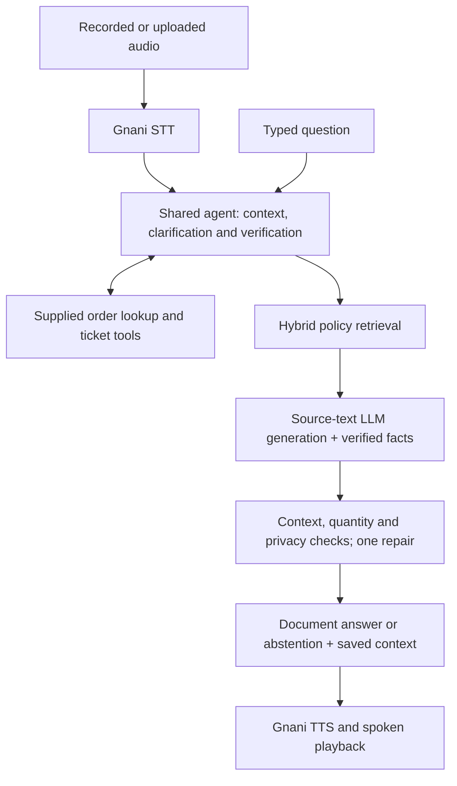

# Resolvox

**Multilingual AI Voice Support for ZentroMart**

**VoiceOps 2026 Capstone**


Resolvox helps online shoppers resolve questions about returns, refunds, deliveries and orders through voice or text. It retrieves ZentroMart policies, verifies access before disclosing private order information, and creates support handover tickets through the supplied tools.

**Primary languages:** English, Hindi and Hinglish.

Built for **From Tokens to Transformers**, Consulting & Analytics Club, IIT Guwahati × Gnani.ai.

[Demo Video](#demo-video) · [Quick Start](#quick-start) · [Architecture](#architecture) · [Evaluation](#evaluation) · [Languages](#language-support) · [Documentation](#documentation)

## Demo Video

> **Space reserved for the final demo video.**

<!-- Add the actual recording link or embedded video here after the final own-voice rehearsal. -->

## What Resolvox Does

| Capability | How it works |
| --- | --- |
| Policy answers with sources | Searches policy sections, supplies actual text to the answer model and saves the complete generation context. |
| Context across turns | Handles follow-up questions, missing details and clarification within one conversation. |
| Verified order support | Checks a phone suffix or delivery pincode before revealing private order information. |
| Confirmed handover | Creates a ticket with the supplied tool and reports success only after confirmation. |
| Voice and text | Uses one shared agent for typed questions and Gnani speech input/output. |
| Uncertainty handling | Attempts one bounded repair of invalid model output, then abstains if a supported answer is unavailable. |

### Customer Workflow

1. **Ask:** type a question, record speech or upload an audio clip.
2. **Clarify:** the agent asks for missing details and verifies order access when needed.
3. **Resolve:** receive an answer with policy sources and, for voice requests, spoken playback.
4. **Escalate:** receive a confirmed handover ticket when the case needs human support.

The Streamlit console provides **Voice support** and **Text support** tabs. Conversation state, redacted transcripts and reply audio persist across reruns. **Retry reply audio** synthesizes the saved answer without repeating the agent action; **New conversation** clears the session and verification state.

## Quick Start

### Prerequisites

- **Python 3.11**, the tested Python version, and Git.
- **Ollama** installed for the default local LLM, or a compatible hosted LLM endpoint.
- Your own **Gnani API key** for speech, available from the [Gnani voice dashboard](https://app.gnani.ai/voice).
- Internet access for the initial dependency, dataset and model downloads, and for Gnani speech calls.

The recorded environment is Windows with Python 3.11. Setup downloads the official synthetic dataset separately, validates it, and obtains the pinned quantized multilingual embedding model. The optional regional translation model is downloaded only when explicitly requested.

### 1. Clone and Install

```sh
git clone https://github.com/Pranay207/Resolvox.git
cd Resolvox
```

**Windows PowerShell:**

```powershell
powershell -ExecutionPolicy Bypass -File .\setup.ps1
```

The Windows setup creates `.venv` and copies `.env.example` to `.env` if needed.

**macOS / Linux:**

```sh
python3.11 -m venv .venv
.venv/bin/python -m pip install --upgrade pip
.venv/bin/python setup.py --models
cp .env.example .env
```

### 2. Configure Speech and the LLM

Edit your local `.env` before launching the app:

```dotenv
GNANI_API_KEY=your_gnani_api_key
LLM_PROVIDER=ollama
LLM_BASE_URL=http://127.0.0.1:11435
LLM_MODEL=qwen3:4b-instruct
LLM_TIMEOUT=600
RAG_LLM_TIMEOUT=600
COMPOSE_WITH_LLM=true
```

Keep the remaining defaults from [.env.example](.env.example), including `REFERENCE_DATE=2026-10-20`. Credentials belong only in the ignored `.env`; use synthetic or consented audio.

Install the model when using the default local Ollama configuration:

```sh
ollama pull qwen3:4b-instruct
```

The recorded local configuration uses **Ollama `qwen3:4b-instruct` on port 11435**. Start its server in a separate terminal:

```powershell
$env:OLLAMA_HOST='127.0.0.1:11435'
ollama serve
```

For macOS/Linux, use `OLLAMA_HOST=127.0.0.1:11435 ollama serve`. The unchanged `.env.example` uses port **11434**; keep the server port and `LLM_BASE_URL` consistent.

<details>
<summary>Use a compatible hosted LLM instead</summary>

Set `LLM_PROVIDER=compatible`, `LLM_BASE_URL`, `LLM_MODEL` and `LLM_API_KEY` in `.env`. Optional `LLM_FALLBACK_*` settings configure a second LLM endpoint. Gnani remains the only speech provider.

</details>

### 3. Launch the Support Console

**Windows PowerShell:**

```powershell
.\.venv\Scripts\python.exe -m streamlit run app.py
```

**macOS / Linux:**

```sh
.venv/bin/python -m streamlit run app.py
```

Open **http://localhost:8501**. Choose the spoken language and **Record** or **Upload**, then send a clip of up to **60 seconds**. Uploads are limited to **20 MB**. Text support uses the same conversation and verification state.

## Organizer Batch Command

With the virtual environment activated, the required command is:

```sh
python run.py --audio_dir <in> --out_dir <out>
```

For example, on Windows:

```powershell
.\.venv\Scripts\python.exe run.py --audio_dir .\input_audio --out_dir .\sample_outputs\batch
```

Each clip produces answer text, JSON, full source chunks and an actual Gnani reply WAV when speech succeeds. `manifest.json` records per-file outcomes and failures. Speech failures are recorded without substitute audio.

<details>
<summary>Audio formats, sessions and exit codes</summary>

- Formats: WAV, MP3, OGG, FLAC, AAC and M4A; Gnani REST clips are limited to 60 seconds, and WAV duration is checked locally.
- Language: `--language hi-IN` selects Hindi; `en-IN` accepts English/Hinglish. Additional routes are listed under [Language support](#language-support).
- Sessions: files are independent by default. In auto mode, `call_id__001.wav` and `call_id__002.wav` share context. Use `--session_mode sequential` for one folder-wide session, or `sessions.json` for explicit mapping.
- Exit codes: `0` means all inputs succeeded, `1` means failed or no inputs, and `2` means usage errors.
- `--offline-rules` disables LLM generation and displays document excerpts for diagnosis, alongside operational guards. It does not enable offline speech/regional translation.
- Raw input audio is not copied to outputs. Verification proofs are redacted from transcripts, tool arguments and model context.

</details>

## Architecture



| Component | Implementation |
| --- | --- |
| Interface | Streamlit voice, text and evaluation console |
| Answer model | Local Ollama `qwen3:4b-instruct`; selected laptop endpoint on port 11435 |
| Retrieval | Lexical search + multilingual MiniLM embeddings using quantized ONNX |
| Speech | Gnani STT and TTS only |
| State and tools | Shared agent session with supplied dataset lookup/ticket tools |
| Optional regional translation | Local NLLB-200 distilled 600M ONNX model |

See [DESIGN.md](DESIGN.md) for the state model, retrieval strategy and evidence boundaries, and [THIRD_PARTY.md](THIRD_PARTY.md) for pinned models and licenses.

## Evaluation

A separate [new-case UI smoke check](sample_outputs/ui_user_smoke_20261031.json) records the card/Plus, wallet follow-up and unsupported delivery-guarantee probes, their initial issues and affected retests.

Recorded verification as of **31 October 2026**:

| Check | Recorded result | Evidence |
| --- | --- | --- |
| Last full engineering run, before the latest refund patch | **3,290 passed**, zero failures, errors or skips | [Verification receipt](sample_outputs/engineering_verification.json) |
| Latest refund-context fixes, targeted tests only | **371 passed**, zero failures, errors or skips | [Targeted verification](sample_outputs/refund_scope_verification_20261031.json) |
| Official dataset validation | **Passed** · 9 CSVs and 21 knowledge-base documents | [Validator output](sample_outputs/engineering_artifacts/20261031T060814584432Z_92c93db5/dataset_validation.log) |
| Selected live conversations and refund edges | **6/6 case groups passed**; live retests and retained-output checks are distinguished | [Targeted evidence](sample_outputs/targeted_live_validation.json) |
| Current primary-language speech batch | **3/3** selected synthetic round trips; Hindi retested separately | [Speech evidence](sample_outputs/targeted_voice_validation.json) |
| Saved policy-question checks | **52/52** accumulated checks across recorded revisions | [Question records](sample_outputs/eval_step2_latest_cases.json) |
| Latest live verification | **Stopped at the owner's request**; confirmation of the latest fixes remains incomplete | [Saved status](sample_outputs/verification_stop_20261031.json) |

Question and conversation totals combine preserved predictions and targeted retests from different revisions. They are local development results, not organizer scores or a fresh complete run of the current revision. The selected conversation/refund checks and three-language synthetic speech batch are recorded separately. Some saved outputs were checked by current validators without fresh inference. The historical baseline uses a different model; it is not a controlled comparison. Each linked receipt identifies its recorded scope and execution revision.

<details>
<summary>Verification commands</summary>

Run with the virtual environment activated. Live commands require the configured model or speech services.

```sh
python Capstone_Project_Dataset_FTTT_2026/validate_dataset.py
python -m pytest -q
python scripts/resume_live_practice.py --step 1
python scripts/resume_live_practice.py --step 2
python scripts/resume_live_practice.py --step 3
python generate_voice_samples.py --reuse-inputs
```

Use separate `--output` files when changing inference inputs. Historical measurements and limitations are documented in [VERIFICATION.md](VERIFICATION.md).

</details>

## Language Support

**English, Hindi and Hinglish are the primary scope.** Select the spoken language before recording. Additional regional languages are an optional preview, disabled by default.

Additional regional routes are experimental and have not been validated for the current revision. See the [recorded language checks](sample_outputs/language_validation.json) before enabling the preview.

<details>
<summary>Configure the optional regional preview and inspect voice routes</summary>

```sh
python scripts/setup_translation.py
```

This separately downloads approximately **907 MB** of pinned NLLB weights. Enable **Advanced options → Extra languages** afterward. Other regional languages use masked local translation around the same agent; placeholder, script and translation checks reject malformed output with a localized retry. These checks do not prove semantic equivalence. Choose Marathi explicitly because Hindi and Marathi share Devanagari; English/Hindi/Hinglish retain their existing path.

| Language | Batch/STT code | TTS voice |
| --- | --- | --- |
| English | `en-IN` | Kaveri |
| Hindi | `hi-IN` | Nalini |
| Hinglish | `en-IN` (TTS `hi-en`) | Poorvi |
| Bengali | `bn-IN` | Kirra |
| Gujarati | `gu-IN` | Falak |
| Kannada | `kn-IN` | Saanvi |
| Malayalam | `ml-IN` | Reshma |
| Marathi | `mr-IN` | Zahira |
| Punjabi | `pa-IN` | Mehuli |
| Tamil | `ta-IN` | Asmita |
| Telugu | `te-IN` | Suhana |

Mappings follow [Gnani's voice catalog](https://docs.gnani.ai/api/TTS/available-voices). Run `python scripts/validate_languages.py --languages te` for a Telugu synthetic pilot, or omit `--languages` for all ten plus Hinglish. Routing, valid audio and grounded meaning are checked separately.

</details>

## Submission Status

**The four-page report is updated and every page has been visually reviewed. No submission ZIP exists.** Current targeted checks and their limitations are linked above. **The demo video will be recorded last**, after the own-voice rehearsal. Final packaging waits for the real demo and confirmed public repository access.

| Deliverable | Status |
| --- | --- |
| Source, dependencies, setup and batch command | Available in this repository; make the repository public before submission |
| Report, maximum four pages | [report.pdf](report.pdf): four pages, updated results and page-by-page visual QA |
| Generated text, sources and speech outputs | [sample_outputs/](sample_outputs/); selected current checks, saved-output validation and historical evidence retain their scopes |
| Demo, maximum two minutes | Reserved above; recording pending |
| Submission archive | No ZIP exists; creation waits for all required evidence and the final demo |

Once the final report, required evidence and `demo.mp4` are ready, build and verify the archive. Packaging currently remains blocked by the recorded submission status:

```sh
python package_submission.py
python scripts/verify_package.py
```

The archive name uses `pranay` as the documented team-name assumption. Packaging excludes credentials, `.env`, the dataset, model weights, caches, virtual environments, the source brief and private input audio. [SUBMISSION_STATUS.json](SUBMISSION_STATUS.json) records readiness and blockers; [BRIEF_CHECKLIST.md](BRIEF_CHECKLIST.md) maps implementation and evidence to the brief.

## Documentation

| Resource | Purpose |
| --- | --- |
| [DESIGN.md](DESIGN.md) | Architecture, retrieval, session state and privacy boundaries |
| [VERIFICATION.md](VERIFICATION.md) | Detailed measurements, historical failures and limitations |
| [BRIEF_CHECKLIST.md](BRIEF_CHECKLIST.md) | Requirement-by-requirement checklist |
| [DEMO_SCRIPT.md](DEMO_SCRIPT.md) | Plan for the final recording |
| [THIRD_PARTY.md](THIRD_PARTY.md) | Model revisions, dependencies and licensing |
| [.env.example](.env.example) | Configuration template without credentials |
| [sample_outputs/](sample_outputs/) | Recorded answer, source, tool and speech evidence |

### Data and API References

- [Official synthetic dataset](https://drive.google.com/file/d/1jeGjWgZJ4vdfmbB71kghovcCUYNeSHOY/view) — downloaded separately by setup.
- [VoiceOps 2026 capstone brief](https://d8it4huxumps7.cloudfront.net/uploads/submissions_case/6ad64c83eae85_voiceops_2026_capstone_brief.pdf).
- [Gnani speech-to-text API](https://docs.gnani.ai/api/STT/speech-to-text) and [text-to-speech API](https://docs.gnani.ai/api/TTS/tts-inference).
- [Multilingual MiniLM embedding model](https://huggingface.co/sentence-transformers/paraphrase-multilingual-MiniLM-L12-v2) — pinned quantized ONNX export; revision and Apache-2.0 attribution in [THIRD_PARTY.md](THIRD_PARTY.md).
